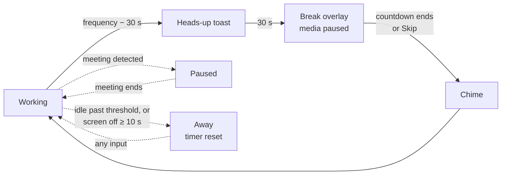

<div align="center">

# WalkAway

**A gentle break reminder that lives in your macOS menu bar.**

Every so often, WalkAway takes over your screens with a calm countdown and a nudge to stand up, stretch, hydrate, or rest your eyes. The rest of the time it stays out of your way: it pauses itself during meetings, resets when you've been away, and pauses your video when a break begins.


</div>

---

## Why WalkAway

Long, unbroken stretches at a screen lead to eye strain, stiff shoulders, and slipping focus. Most break timers are easy to ignore, or they interrupt you at the worst moment. WalkAway is built to be hard to ignore when a break is due and invisible when it shouldn't bother you.

## Features

### A real break, not a notification
- **Full-screen overlay on every display** with an animated night-sky background, a large countdown, and a rotating motivational message.
- **30-second heads-up** toast before every break, so you can wrap up your thought.
- **Short and long breaks.** Short breaks can be skipped. Every **3rd break is a long one and can't be skipped**.
- **A soft chime** when the break ends.

### Smart enough to stay out of your way
- **Pauses for meetings.** Detects active **Zoom**, **Microsoft Teams**, and **Webex** calls, pauses the timer, and resumes automatically when the call ends.
- **Pauses your media.** When a break starts, whatever is playing (a YouTube video in Safari, Music, Spotify, …) is paused, so it doesn't keep running behind the overlay. Media that's already paused stays paused.
- **Knows when you're away.** After a minute with no keyboard or mouse input, the countdown freezes, so a break never fires at an empty desk. Idle past your threshold and the cycle resets. It stays reset until you're back.
- **Counts screen-off time as a break.** If the screen saver, lock screen, display sleep or Mac sleep lasts 10 seconds or more, the cycle starts fresh.
- **Knows watching isn't idling.** Watching a video with no input still counts as screen time, so the timer keeps running.

### Comfortable to live with
- Lives in the menu bar only: no Dock icon, no windows.
- See time until the next break at a glance; pause or resume at any time.
- Optional **Launch at Login**.

## Settings

Click the walking-figure icon in the menu bar to open settings.

| Setting | Default | Range |
| --- | --- | --- |
| Break frequency | 30 min | 30–120 min |
| Short break | 30 sec | 30–180 sec |
| Long break (every 3rd break) | 5 min | 5–30 min |
| Reset after inactivity | 10 min | 5–60 min |
| Pause for meeting apps | Off | On / Off |
| Launch at Login | Off | On / Off |

## How a break cycle works



The countdown only runs while you're actually at your Mac:

| Situation | Countdown |
| --- | --- |
| You're typing or using the mouse | Runs |
| A video is playing, even without input | Runs |
| No input for 60 seconds | Frozen |
| No input past your inactivity threshold | Reset to the full interval, shown as **Away** until you're back |
| Screen saver, lock, display or Mac sleep for 10 s or more | Reset, shown as **Away** |
| A meeting is detected | Paused, never reset |

## Getting started

### Requirements
- macOS 15.2 or later
- Xcode 16 or later

### Run from Xcode
```bash
git clone https://github.com/mrinesh/WalkAway.git
cd WalkAway
open WalkAway.xcodeproj
```
Press **⌘R**. The project is set to *Sign to Run Locally*, so you don't need an Apple Developer account.

### Install a Release build
```bash
xcodebuild -project WalkAway.xcodeproj -scheme WalkAway \
  -configuration Release -derivedDataPath build build
cp -R build/Build/Products/Release/WalkAway.app /Applications/
open /Applications/WalkAway.app
```

To quit, open the menu bar popover and click **Quit WalkAway** (or press **⌘Q** while it's open).

## Privacy

- **Nothing leaves your Mac.** No network access, no analytics, no accounts.
- Settings are stored locally in `UserDefaults`.
- Meeting detection only looks at which apps are running, their window titles, and CPU usage. It never accesses your camera, microphone, or meeting content.

## Under the hood

| File | Responsibility |
| --- | --- |
| [`WalkAwayApp.swift`](WalkAway/WalkAwayApp.swift) | App entry point and `AppDelegate`: break timers, pause/resume, meeting detection, inactivity tracking, sleep/wake, Launch at Login, the settings popover, and the heads-up toast. |
| [`BreakScheduler.swift`](WalkAway/BreakScheduler.swift) | The work-timer state machine (working, on break, away). It holds no timers and reads no system state, so it's fully unit tested. |
| [`SystemActivity.swift`](WalkAway/SystemActivity.swift) | Reads system idle time and whether a video is keeping the display awake. |
| [`OverlayWindowController.swift`](WalkAway/OverlayWindowController.swift) | The full-screen break window, one per display, with its animated background and Skip button. |
| [`MediaController.swift`](WalkAway/MediaController.swift) | Pauses system-wide “Now Playing” media when a break starts. |
| [`welcome.mp3`](WalkAway/welcome.mp3) | The end-of-break chime. |

### Idle and screen-off detection
Once a second, WalkAway asks macOS how long it has been since the last keyboard, mouse or trackpad input (`CGEventSource.secondsSinceLastEventType`). This covers the whole system and needs no permissions. To tell whether a video is playing, it checks whether any app is keeping the display awake (`PreventUserIdleDisplaySleep`), which video players do and music players don't.

Screen-off is tracked as a set of reasons: screen saver, lock screen, display sleep, system sleep and switching users. The screen only counts as back once every reason has cleared, so a screen saver that turns into a lock screen is measured as one stretch. Durations use the wall clock, so time spent asleep counts.

### Meeting detection
Every 2 seconds, while the option is on, WalkAway checks each meeting app in turn:

| App | Signal |
| --- | --- |
| Zoom | The in-meeting helper process (`CptHost`) is running |
| Webex | The meeting host process (`washost`) is running |
| Teams | Average CPU use stays above 10% for about 10 seconds |

### Pausing media
macOS has no public API to control another app's playback. Since macOS 15.4, the private `MediaRemote` framework also refuses requests from third-party apps. WalkAway gets around this by running a short script with Apple's own `/usr/bin/perl`, which macOS still allows to use `MediaRemote`. The script checks whether anything is playing and, if it is, sends an explicit **Pause** command. It never sends a play/pause toggle, so it can't accidentally resume something. If the script fails, WalkAway sends the Pause command directly as a fallback.

This approach needs the app to run **outside the App Sandbox**, which is why WalkAway isn't distributed through the Mac App Store.

### Testing tip
Waiting 30 minutes for a break gets old. In `WalkAwayApp.swift`, set:
```swift
private let testingBreakFrequencyMinutes: Int? = 1
```
to get a break every minute. Set it back to `nil` before committing.

To run the unit tests:
```bash
xcodebuild test -project WalkAway.xcodeproj -scheme WalkAway -only-testing:WalkAwayTests \
  CODE_SIGN_IDENTITY=- CODE_SIGN_STYLE=Manual DEVELOPMENT_TEAM=
```

## Known limitations

- **Media pausing relies on private macOS behavior** and could break in a future macOS update.
- Only the app macOS considers “Now Playing” is paused, which is usually the one you used most recently.
- Teams detection is a heuristic and can occasionally misfire.
- Anything that keeps the display awake counts as watching video, so the away reset won't trigger while it runs. That includes Amphetamine, `caffeinate -d`, Keynote and Zoom calls.
- Browser-based meetings (Google Meet, Teams on the web) aren't detected.

## Contributing

Issues and pull requests are welcome. If you're adding support for a new meeting app, implement the `MeetingDetector` protocol in `WalkAwayApp.swift` and register it in `MeetingMonitor`.

## Acknowledgements

The Perl-based `MediaRemote` workaround is inspired by [ungive/mediaremote-adapter](https://github.com/ungive/mediaremote-adapter).
